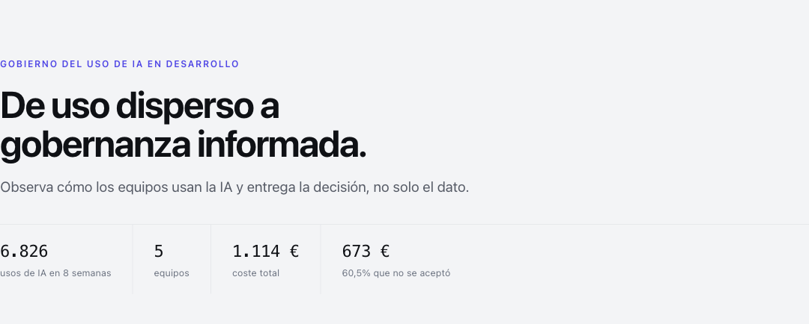
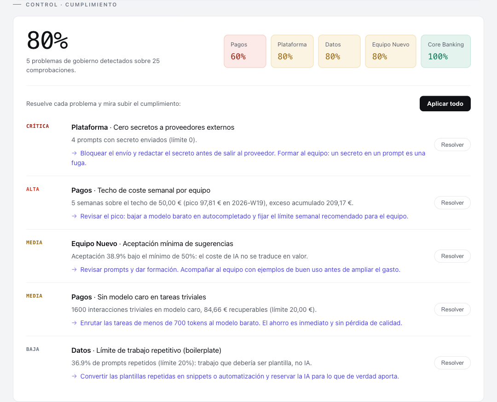
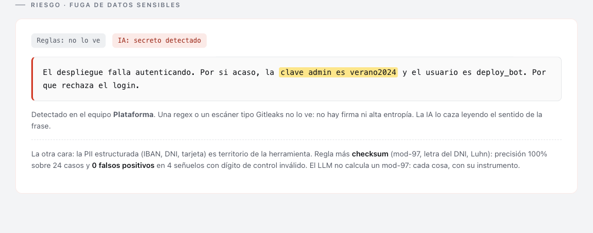
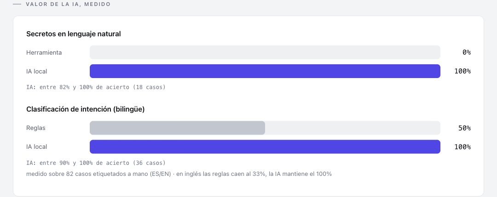
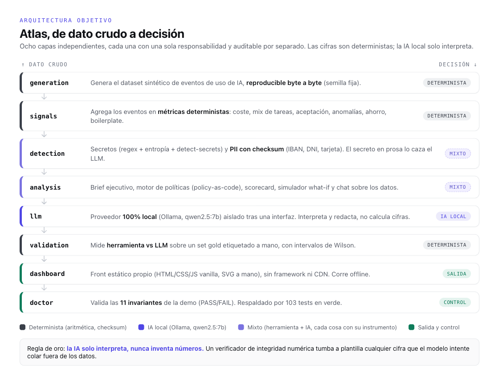

# Atlas

**El copiloto que audita a los copilotos.** Un prototipo local y de solo lectura
para gobernar el uso de IA en equipos de desarrollo: convierte telemetría
exportada en señales de coste, riesgo, adopción y cumplimiento que se pueden
revisar y reproducir.


<p align="center">
  
</p>

> Proyecto presentado por **Javier González Casares** en la **Hackathon Cátedra
> Atmira × OpenAI × Big Data 2026**, categoría junior, como propuesta para el
> Reto 4: gobierno y control del uso de IA en desarrollo.

## El problema

Cuando una organización despliega copilotos, el uso queda repartido entre miles
de interacciones. Resulta difícil responder con evidencia a preguntas sencillas:

- ¿Cuánto cuesta la IA y qué parte del gasto no se traduce en uso?
- ¿Qué equipos emplean modelos caros para tareas pequeñas?
- ¿Se están copiando secretos o datos personales en los prompts?
- ¿Se cumple la política interna y qué acción corrige cada incumplimiento?

Atlas analiza un export de prompts, respuestas, tokens, modelos, costes y tipo de
tarea. No intercepta ni bloquea tráfico: es un control **detective**, local y
read-only que observa el histórico, cuantifica los hallazgos y propone acciones.

En el escenario sintético presentado se analizaron 6.826 usos durante ocho
semanas. El coste total fue de 1.113,82 €, de los que 673,32 € (60,5 %) estaban
asociados a respuestas que no se aceptaron. Esa última cifra es una señal de
eficiencia, **no un ahorro recuperable directo**. El ahorro inmediato estimado
por enrutar tareas pequeñas a un modelo más económico fue de 84,66 € en ocho
semanas para un equipo.

## Qué entrega

- **Brief de gobernanza.** Un LLM local redacta la explicación; un verificador
  comprueba que las cifras proceden de los datos y activa una plantilla segura
  si detecta números ajenos.
- **Política como código.** `policy.yaml` define las reglas. El motor calcula
  cumplimiento, evidencia, severidad, responsable y remediación sin delegar la
  decisión en el modelo.
- **FinOps para IA.** Detecta anomalías de coste, modelos sobredimensionados y
  simula el impacto de ajustar una regla.
- **Seguridad con el instrumento adecuado.** Regex, entropía y `detect-secrets`
  cubren secretos estructurados; checksums validan y enmascaran IBAN, DNI y
  tarjetas; el LLM local se reserva para secretos escritos en prosa.
- **Salud semanal.** Un scorecard muestra si seguridad, coste, eficiencia y
  adopción mejoran o se deterioran.
- **Dashboard offline.** HTML, CSS y JavaScript sin framework ni CDN, con un
  snapshot sintético incluido para abrir la demo recién clonada.

### De la política a una acción revisable

En la demo, cinco reglas aplicadas a cinco equipos generan 25 comprobaciones y
cinco incumplimientos. La interfaz permite simular sus remediaciones y visualizar
el paso del 80 % al 100 % de cumplimiento.



### IA donde aporta; reglas donde bastan

Una contraseña escrita dentro de una frase no tiene necesariamente una firma o
entropía reconocible. Atlas usa el modelo local para interpretar ese caso, pero
mantiene fuera del LLM los cálculos, los límites y la PII con checksum.

> La contraseña visible en esta captura es **un dato sintético de prueba** y no
> una credencial real.



La versión presentada midió este reparto sobre sets gold pequeños y etiquetados
a mano. Los resultados describen el prototipo, no constituyen un benchmark
general de modelos.



## Arquitectura

Atlas separa el dato crudo de la decisión en ocho capas. Las cifras, la política
y los checksums son deterministas; Ollama queda aislado detrás de una interfaz y
solo interpreta o redacta.

La captura corresponde a la versión presentada en la competición, que mostraba
103 pruebas. Esta exportación pública añade cuatro pruebas de hardening y ejecuta
107 en total.



```text
generation → signals → detection → analysis → llm → validation → dashboard → doctor
```

| Capa | Responsabilidad |
| --- | --- |
| `generation` | Generar telemetría sintética desde una semilla fija |
| `signals` | Calcular coste, aceptación, anomalías, ahorro y repetición |
| `detection` | Detectar secretos y validar PII estructurada |
| `analysis` | Producir brief, política, scorecard, what-if y chat |
| `llm` | Proveedor Ollama local, sustituible tras una interfaz |
| `validation` | Comparar herramientas y LLM con intervalos de Wilson |
| `dashboard` | Exportar una interfaz estática y offline |
| `doctor` | Verificar los invariantes de la demo |

## Probarlo en local

### Demo visual inmediata

El repositorio incluye únicamente código, configuración, tests, sets sintéticos
y el snapshot necesario para la demo. No contiene el entregable, notas internas,
telemetría real ni credenciales.

```bash
git clone https://github.com/i12gocaj/Atlas.git
cd Atlas
open dashboard/index.html      # macOS
# En Linux/Windows, abre dashboard/index.html con tu navegador.
```

El dashboard funciona sin servidor y sin Ollama mediante
`dashboard/data.demo.js`.

### Pipeline completo

Requisitos:

- Python 3.10 o superior.
- `make` para los atajos del proyecto.
- [Ollama](https://ollama.com/) y `qwen2.5:7b` solo para las fases que usan LLM.

```bash
python3 -m venv .venv
source .venv/bin/activate
python -m pip install --upgrade pip
pip install -e ".[dev]"

ollama pull qwen2.5:7b
ollama serve                    # en otra terminal, si todavía no está activo

make demo                       # datos + análisis + dashboard + doctor
make serve                      # http://127.0.0.1:8777
```

También se incluye `uv.lock` para una instalación resuelta y repetible con
[`uv`](https://docs.astral.sh/uv/):

```bash
uv sync --extra dev
source .venv/bin/activate
```

Comandos útiles:

```bash
make test                       # suite automática
make doctor                     # invariantes de la demo
make data                       # capas deterministas, sin LLM
atlas policy                    # auditar policy.yaml
atlas validate-pii              # evaluar checksums y enmascarado
```

Para analizar texto potencialmente sensible, evita ponerlo en el historial del
shell. Usa la entrada estándar; Atlas no vuelve a imprimir el valor recibido:

```bash
printf '%s' 'texto sintético de prueba' | atlas scan
```

## Configuración y privacidad

Atlas usa por defecto `http://localhost:11434` y no necesita claves de API. La
configuración opcional está documentada en `.env.example`:

```bash
cp .env.example .env
```

`ATLAS_OLLAMA_HOST` es configurable. Si se apunta a otro host, deja de cumplirse
la propiedad local-first; no envíes telemetría sensible a un endpoint remoto.
El prototipo conserva texto para poder demostrar la detección, por lo que debe
usarse únicamente con los datos sintéticos incluidos. Antes de conectarlo a
telemetría real harían falta controles adicionales de minimización, cifrado,
retención, acceso y redacción.

Consulta [SECURITY.md](SECURITY.md) para el modelo de uso seguro y el canal de
reporte de vulnerabilidades.

## Alcance honesto

- El dataset es sintético y se regenera con semilla fija (`42`).
- Atlas audita exports; no es un proxy, DLP ni control preventivo en tiempo real.
- Los 673,32 € de respuestas no aceptadas son una señal para investigar, no una
  promesa de ahorro.
- El simulador de ahorro compara tarifas y volumen de tokens; no mide por sí solo
  la calidad del modelo alternativo, que debe validarse antes de desplegarlo.
- Los porcentajes de evaluación proceden de sets pequeños del prototipo.
- Las capas deterministas sí se reproducen; la prosa del LLM puede variar entre
  versiones o ejecuciones del modelo local.
- La integración con gateways, IDEs y fuentes corporativas queda fuera de esta
  prueba de concepto.

## Estructura del repositorio

```text
src/atlas/       núcleo Python y CLI
dashboard/       interfaz estática y snapshot sintético
tests/           pruebas automatizadas
validation/      sets gold y generador de fixtures
scripts/         benchmark local de modelos
docs/images/     capturas de la propuesta presentada
policy.yaml      política de ejemplo como código
```

## Hackathon

Atlas fue desarrollado y presentado por **Javier González Casares** el 10 de
julio de 2026 en la **Hackathon Cátedra Atmira × OpenAI × Big Data**, categoría
junior. La propuesta respondió al **Reto 4 — Gobierno y control del uso de IA en
desarrollo**.

> Atlas no está para recortar la IA, sino para dirigirla.
